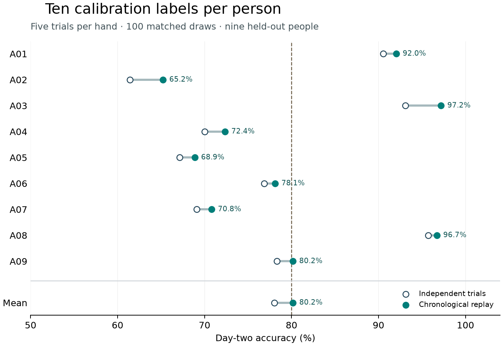

# Adaptive EEG motor-imagery decoder

Can a decoder recognize imagined left- and right-hand movement on a second recording day after just five labeled examples per hand? In this nine-person retrospective study, chronological replay reached **80.16% mean day-two accuracy**, compared with **78.03%** when each trial was scored independently.

[Try the interactive EEG replay](https://skylergrossi7-ops.github.io/adaptive-eeg-decoder/demo/EEG_Replay.html) · [Read the research report (PDF)](report/Motor_Imagery_Research_Report.pdf) · [Inspect participant-level results](results/ensemble-verified.csv)

Open the replay and press **Play**. The arrow shows the instruction given to the participant. Compare it with each decoder's guess on the same recorded trial, then switch participants to see how performance varies.



## Experiment

We held out one Graz participant at a time, sampled five day-one trials per hand, and scored eligible day-two trials. Both protocols used the same 100 calibration draws per person and the same 1,183 distinct evaluation trials across the cohort. Repeated draws measure sensitivity to the calibration examples. They reuse the same nine people.

The ensemble averages scores from four EEG representations covering spatial covariance, shorter time windows, cross-spectral features, and amplitude envelopes. The chronological protocol uses earlier unlabeled EEG to update its reference for subsequent decisions. The repository also includes the CSP + LDA and PyTorch EEGNet implementations used in the baseline experiments.

| Protocol | Mean accuracy | Left recall | Right recall |
| --- | ---: | ---: | ---: |
| Independent trials | 78.03% | 74.93% | 81.09% |
| Chronological replay | 80.16% | 80.94% | 79.35% |

Each person has equal weight. Replay improved overall accuracy for all nine people, although mean right-hand recall fell. Across participants, the bootstrap 95% interval for replay accuracy was 72.84–87.89%. The task assumes a known cue and a completed EEG epoch. Generalization to an untouched cohort and clinical use remain open questions.

## Reproduce the comparison

From the repository root in a Python environment, install the three numerical dependencies and recompute both protocols from the archived component scores.

```sh
python -m pip install numpy==2.4.6 pandas==3.1.1 scipy==1.17.1
python experiments/multiview_replay.py scores outputs/recomputed
```

Compare the 18 rows in `outputs/recomputed/results.csv` with [the independently verified results](results/ensemble-verified.csv). The columns contain per-hand recall, balanced accuracy and accuracy in percent. The [calibration manifest](results/support.csv) identifies the trials for each draw. This quick reproduction starts after the component models have scored the trials.

For the modeling code, see [CSP + LDA](eeg_bci/model.py), [EEGNet](eeg_bci/eegnet.py), the [ensemble](experiments/multiview_replay.py), and the [chronological verification checks](experiments/verify_motor_ensemble.py). The full Windows CPU environment is recorded in [the dependency file](requirements-eegnet-win-cpu.txt). Run the neural-network checks with `python -m unittest discover -s tests` in that environment.

## Data and attribution

The Graz recordings are BCI Competition IV Dataset 2a, provided by Clemens Brunner, Robert Leeb, Gernot Müller-Putz, Alois Schlögl and Gert Pfurtscheller at Graz University of Technology. The demo includes downsampled C3, Cz and C4 traces. External source training used motor imagery from the PhysioNet EEG Motor Movement/Imagery Dataset. Consult the report for methods and references, and the original providers for full recordings. [BCI Competition IV](https://www.bbci.de/competition/iv/) · [PhysioNet EEGMMIDB](https://physionet.org/content/eegmmidb/1.0.0/)
